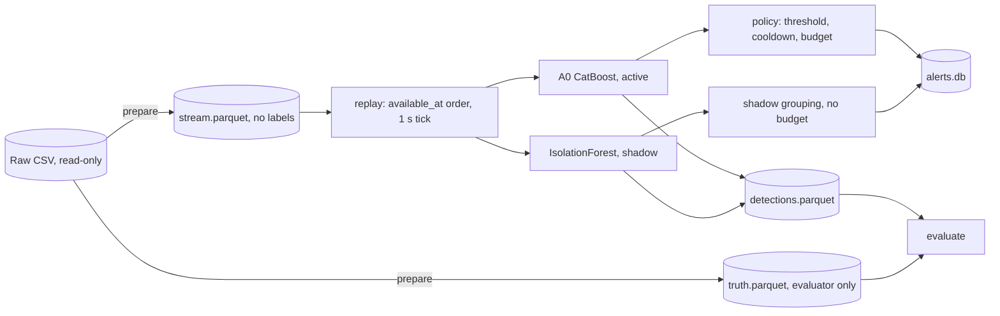

# Netirava

IDS dựa trên **flow đã hoàn tất**, chạy bằng **dataset replay** trên NF-CSE-CIC-IDS2018-v3. Gồm:
- **A0**: CatBoost theo công thức anchor NP-v1, train lại trên CIC; chạy ở chế độ active.
- **IsolationForest**: anomaly detector chạy ở chế độ shadow (chỉ quan sát).

Phản ứng chỉ là mô phỏng (incident/notification): không block, không quarantine, không tự train lại.

| Tài liệu | Nội dung |
|---|---|
| [`docs/RESULTS_FINAL.md`](docs/RESULTS_FINAL.md) | **Kết quả cuối**: (a) lớp hiếm, (b) triage theo incident, tấn công thay đổi, chi phí |
| [`docs/RESEARCH_FRAMING.md`](docs/RESEARCH_FRAMING.md) | Bài toán theo đề chính thức, research question, protocol, metric, luật chứng minh |
| [`docs/DATASET_CARD.md`](docs/DATASET_CARD.md) | Subset CIC18-Causal-Demo-v1: cửa sổ, vai trò, support, host overlap, giới hạn |
| [`docs/MODEL_CARD_A0.md`](docs/MODEL_CARD_A0.md) | A0-CIC |
| [`docs/RESULTS_MVP.md`](docs/RESULTS_MVP.md) | Kết quả run MVP |
| [`docs/RESULTS_DECISION.md`](docs/RESULTS_DECISION.md) | Decision layer V1–V4b: dev (Bot, Web) và holdout DDoS |

## Cấu trúc
```text
configs/demo.yaml        cửa sổ, vai trò, known class, threshold target, policy (chốt trước khi train)
src/netirava/
  cli.py                 python -m netirava <command>
  config.py              load YAML, path, sha1
  features.py            allowlist 49 feature, transform cố định, fingerprint, runtime contract (không nhãn)
  dataset.py             inspect / prepare (stream.parquet không nhãn + truth.parquet) / audit
  detectors.py           A0 (CatBoost) và Anomaly (IsolationForest), threshold trên calibration
  replay.py              replay causal theo available_at, fast/paced, shadow cô lập
  policy.py              candidate → incident theo entity, cooldown và budget theo event time
  storage.py             run.json, detections.parquet, alerts.db (feedback append-only)
  evaluation.py          evaluator (module duy nhất đọc nhãn), ablation imbalance
  app.py                 giao diện triage (Streamlit): hàng incident, chi tiết, feedback
  decision.py            decision layer offline: V1 A0, V2 anomaly, V3 OR, V4a/V4b entity + ablation, nhiều mức FPR
tests/                   pipeline end-to-end trên dữ liệu tổng hợp
```

Ngoài git:
- `datasets/` (dữ liệu gốc, chỉ đọc);
- `artifacts/` (subset dẫn xuất, model);
- `runs/` (các run replay).



## Ranh giới (đều có test)
- **Nhãn:** model input chỉ gồm 49 feature trong allowlist (giữ port, TTL, DNS id). Nhãn, role và scenario không bao giờ đi vào runtime; `features.flow_event_batch` từ chối các cột đó.
- **Threshold và model chỉ học từ train/calibration:** đảo nhãn của dữ liệu replay không làm đổi threshold hay prediction.
- **Prefix invariance:** prefix của stream cho kết quả giống hệt khi chạy cả stream. Thay đổi chunk size, hay chạy paced thay vì fast, không làm đổi kết quả.
- **Shadow cô lập:** bật/tắt shadow, kể cả khi shadow lỗi, đều cho cùng `active_decisions_sha1`. Lỗi shadow làm run được đánh dấu `degraded`.
- **Ngữ nghĩa score:** `attack_score = 1 − p(Benign)` là score để ra quyết định, không phải xác suất đã calibration. Không có fusion giữa hai nhánh.

## Cài đặt và chạy (Windows, PowerShell)
```powershell
cd D:\Downloads\DataNova\Netirava
uv sync
.venv\Scripts\python.exe -m pytest -q

$py = ".venv\Scripts\python.exe"
& $py -m netirava inspect  --config configs/demo.yaml      # sha1, schema, hourly class counts
& $py -m netirava prepare  --config configs/demo.yaml      # windows -> stream/truth/manifest
& $py -m netirava audit    --config configs/demo.yaml      # host / fingerprint overlap, collisions
& $py -m netirava train-a0 --config configs/demo.yaml --variant a0   # GPU; a1 = no SMOTE, a2 = SqrtBalanced
& $py -m netirava ablate-imbalance --config configs/demo.yaml          # per-class (rare) metrics of a0/a1/a2
& $py -m netirava train-anomaly --config configs/demo.yaml
& $py -m netirava replay --config configs/demo.yaml --mode a0-shadow            # fast
& $py -m netirava replay --config configs/demo.yaml --mode a0-shadow --pace paced --speed 60 --segments R1_0302_bot --max-events 30000
& $py -m netirava score-calibration --config configs/demo.yaml
& $py -m netirava decide --run <dev_run_id>                     # dev scenarios, all FPR levels
& $py -m netirava replay --config configs/demo.yaml --mode a0-shadow --segments H1_0220_ddos --unlock-holdout
& $py -m netirava decide --run <holdout_run_id> --unlock-holdout # only after the method is frozen
& $py -m netirava evaluate  --run <run_id>
& $py -m netirava ui --run <run_id>                               # triage interface (http://localhost:8501)
& $py -m netirava incidents --run <run_id> --limit 5
& $py -m netirava feedback  --run <run_id> --alert-id 1 --status true_positive --source analyst --confirmed-by <name>
```
- Mỗi lần `replay` tạo một run mới tại `runs/<run_id>/`; đây cũng là cách resume duy nhất (không skip theo file đã tồn tại).
- A0 kế thừa `../experiments/nextphase/configs.yaml` (NP-v1) nếu file đó tồn tại.
