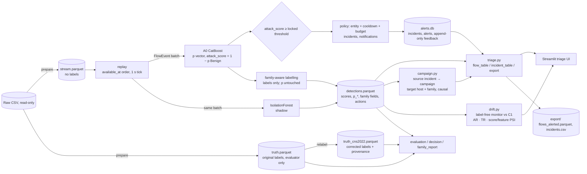

# Netirava — architecture

**Netirava là IDS chạy trên flow đã hoàn tất** (NetFlow v3 của NF-CSE-CIC-IDS2018-v3), dùng dataset replay, với phản ứng mô phỏng (incident/notification). Nó không phải packet IPS, không block, không quarantine và không tự train lại.

## Pipeline
**Flow → CatBoost A0 → quyết định Attack/Benign → nhãn family-aware → gom incident → correlation theo campaign → triage UI**, với **drift monitor** chạy song song (không đổi quyết định)

## Module (`src/netirava/`)
| Module | Trách nhiệm | Đọc nhãn? |
|---|---|---|
| `config.py` | YAML, path, sha1 | — |
| `features.py` | Allowlist 49 feature, transform cố định, fingerprint, runtime contract (`flow_event_batch` từ chối mọi cột nhãn) | Không |
| `dataset.py` | `inspect`, `prepare` (cửa sổ, scope host → stream/truth/manifest), `audit` | Chỉ ở phía evaluator/audit |
| `detectors.py` | A0 (`train_a0`, các biến thể a0/a1/a2, seed), Anomaly (`train_anomaly`); threshold trên benign của calibration | Chỉ train/calibration |
| `replay.py` | Replay causal (fast/paced); chấm A0 và shadow; gọi policy; ghi family fields; `--model` chọn A0 (mặc định `a0`, hoặc `pilot_cns/sN`); ghi git commit vào run | **Không** |
| `family.py` | **Implementation duy nhất** của family-aware: `annotate`, `annotate_frame` (cho run cũ), `incident_labels` | Không |
| `policy.py` | Candidate → incident (entity, cooldown theo event time), budget theo giờ mô phỏng | Không |
| `triage.py` | `flow_table`, `incident_table`, `campaign_table`, `export`: view dùng chung cho UI và export; severity family-aware; `notified` (FIFO runtime) tách khỏi `queue_rank_*` | Không |
| `campaign.py` | Correlator causal (khóa = host đích + họ dự đoán, không gộp hai campaign), `update_items` (campaign update theo giờ), `review_queue` (**một** hàm hàng xem xét cho mọi đơn vị) | **Không** |
| `drift.py` | Reference C1 theo model (`drift_reference.json`), tín hiệu theo cửa sổ 15 phút (AR, TR, S_PSI, F_PSI), luật báo động, `DRIFT_MONITOR.parquet` | **Không** |
| `storage.py` | Thư mục run: `run.json`, `detections.parquet`, `alerts.db` | — |
| `app.py` | Streamlit UI: hàng incident (severity hoặc volume, top-B mỗi giờ), chi tiết, lý do uncertain, feedback | Không |
| `evaluation.py` | Evaluator theo scenario; ablation imbalance; minority report; FP profile; family report | **Có** (chỉ module này và các module dưới) |
| `decision.py` | Decision layer offline V1–V4b, nhiều mức FPR, metric incident và triage | Có |
| `ops.py` | Evaluator của ops study: metric correlation (RQ-C), FPR thực theo cửa sổ (RQ-D), so sánh model (RQ-M), luật GO, bảng tóm tắt | Có |
| `relabel.py` | Nhãn sửa theo CNS2022 (file riêng; không đổi nhãn gốc) | Có |
| `pilot.py` | Pilot A0 trên nhãn đã sửa (3 seed), so với A0 v2 | Có |
| `registry.py` | Sinh `docs/EXPERIMENT_REGISTRY.generated.md` từ metadata | — |
| `cli.py` | Mọi lệnh `python -m netirava …` | — |

## Contract của detections (mỗi flow)
- **Định danh và thời gian:** `flow_id, segment, entity, available_at, decision_at, batching_delay_ms`.
- **A0:** `a0_pred` (argmax), `a0_score`, `a0_candidate`, `p_<class>…`.
- **Policy:** `active_action, active_reason, incident_id`.
- **Family-aware** (từ bản tích hợp; run cũ được tính lúc load bằng cùng code): `predicted_family, fine_label, fine_label_status ∈ {fine, uncertain, benign}, fine_confidence, family_mass, uncertainty_reason`.
- **Shadow:** `an_score, an_would_alert, an_status, shadow_incident_id`.
- **Correlation** (từ ops study; run cũ được tính lúc load bằng cùng code): `campaign_id` (0 = không alert). `update_id` (campaign update) được tính trong `triage.flow_table`.

## Bất biến (đều có test)
- Nhãn không lọt vào runtime.
- Threshold và model chỉ học từ train/calibration.
- Prefix invariance; chunking và paced cho kết quả giống fast.
- Shadow cô lập.
- **Family-aware không đổi xác suất, alert, policy hay incident** (`test_replay_family_columns_do_not_change_active_decisions`). Trên dữ liệu thật, hash quyết định active trùng với run trước khi tích hợp.
- Feedback append-only.
- Run cũ đọc được (`test_flow_table_backward_compatible_with_old_runs`).
- **Correlation không đổi alert hay incident** (`test_replay_campaigns_do_not_change_active_decisions`); trên dữ liệu thật, `active_decisions_sha1` của A0 v2 dev vẫn là `1c7b4b31…`. Gán campaign là causal (`test_campaign_assignment_is_causal_prefix_invariant`); tấn công mới gia nhập campaign cũ có mục xem xét riêng (`test_new_source_joining_old_campaign_is_a_new_review_item`).
- **Drift monitor không đọc nhãn** (`test_monitor_is_label_free`). Incident uncertain không nhận severity của lớp mịn bị giấu (`test_uncertain_flow_never_gets_withheld_class_severity`).

## Model
| Model | Thư mục | Ghi chú |
|---|---|---|
| **A0 v2 (mặc định)** | `artifacts/models/a0` | 8 known class, nhãn gốc, threshold 0.8679; model card ở [`MODEL_CARD_A0_v2.md`](MODEL_CARD_A0_v2.md) |
| Pilot | `artifacts/models/pilot_cns/s{0,1,2}` | Nhãn đã sửa. Dùng độc lập (`--model pilot_cns/s0`); **chưa** là mặc định |
| A0 v1 | `artifacts/models_v1/a0` | Mô tả ở [`history/MODEL_CARD_A0_v1.md`](history/MODEL_CARD_A0_v1.md); cần cho các run MVP và holdout H1 |
| Ablation | `a1*`, `a2*`, `a0_s1`, `a0_s2` | |
| Anomaly | `artifacts/models/anomaly` | |
