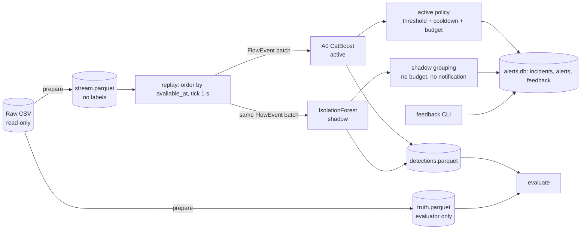

# Kiến trúc Netirava MVP

**Netirava MVP là một IDS dựa trên flow đã hoàn tất, chạy trên dữ liệu replay, với phản ứng mô phỏng.** Nó không phải packet-level IPS, không block hay quarantine thật, và không tự train lại.

## Module
| Module | Vai trò |
|---|---|
| `config.py` | Load YAML, resolve path, sha1 |
| `features.py` | Allowlist 49 feature (`nfv3-49-allowlist-v1`); danh sách cột không bao giờ được làm input; transform cố định cho anomaly; fingerprint |
| `contracts.py` | `FlowEvent` (không có nhãn), `DetectionResult`, `Alert`, `Feedback`. `flow_event_batch` từ chối mọi cột nhãn hoặc cột của evaluator |
| `dataset.py` | `inspect` (profile streaming bằng pyarrow), `prepare` (cửa sổ → stream/truth/manifest), loader. `training_frame` chỉ cho phép vai trò train/calibration |
| `detectors/a0.py` | CatBoost theo công thức NP-v1, class map, SMOTE guard (SMOTENC; báo lỗi nếu class quá nhỏ), threshold trên calibration, model card |
| `detectors/anomaly.py` | IsolationForest fit trên benign của train; score = −score_samples; threshold trên benign của calibration |
| `replay.py` | Thứ tự causal, tick quyết định, chunk vector hóa (fast) hoặc từng tick (paced), shadow có try/except và cờ late, ghi log run |
| `policy.py` | Threshold → candidate → incident theo entity, cooldown theo event time, budget theo giờ mô phỏng; reset khi qua ranh giới segment |
| `storage.py` | Thư mục run: `run.json`, `detections.parquet`, `alerts.db` (feedback append-only, chặn bằng trigger) |
| `evaluation.py` | Module duy nhất join kết quả với nhãn; báo cáo theo từng scenario, proxy episode, shadow, vận hành |
| `audit.py` | Support, fingerprint overlap, host overlap, collision |

## Ranh giới an toàn (đều có test)
- **Nhãn không lọt vào runtime:** stream không có cột nhãn; contract chặn cột `role`/nhãn; `replay`, `policy` và `detectors` không gọi `load_truth`.
- **Không dùng dữ liệu replay để học:** threshold và model chỉ dùng train/calibration; test kiểm tra rằng đảo nhãn của replay không làm đổi threshold hay prediction.
- **Prefix invariance:** prediction và policy trên một prefix không đổi khi thêm suffix. Chunk 7 event cho kết quả giống chunk 500; paced giống fast.
- **Shadow cô lập:** bật hay tắt shadow, kể cả khi shadow ném lỗi, đều cho cùng hash `active_decisions_sha1`; lỗi shadow làm run được đánh dấu `degraded`.
- **"Độc lập" chỉ có nghĩa là:** hai detector nhận cùng `FlowEvent` và không chặn nhau, không dùng output của nhau. Không có nghĩa hai score độc lập về mặt thống kê. Không có fusion.

## Ngoài phạm vi
Kafka/Redis, microservice, UI, HPO, specialist, graph model, gate hai tầng, retrain tự động, firewall/EDR thật, SHAP online.
