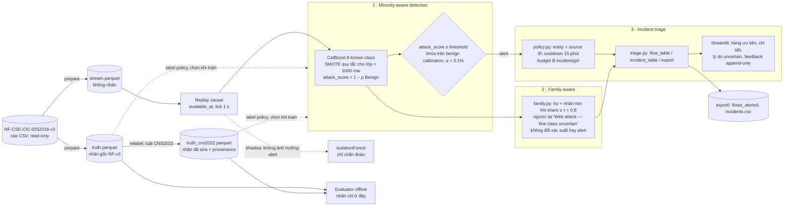

# Netirava: kiến trúc giải pháp cuối (chốt 2026-11-08)

Đề DN-CY-01 "Network Intrusion Detection with Imbalanced Threat Data" yêu cầu hai output:
- (a) model vững trên minority classes;
- (b) alert triage interface.

Netirava chốt **ba thành phần** cho hai output đó:

| # | Thành phần | Output đề bài | Trạng thái |
|---|---|---|---|
| 1 | **Minority-aware intrusion detection:** CatBoost, xử lý mất cân bằng, kiểm soát chất lượng nhãn | (a) | Đã chạy. Model và chính sách nhãn cuối **chờ chốt** (quyết định D1–D2 trong [`FINAL_COMPLETION_PLAN.md`](FINAL_COMPLETION_PLAN.md)) |
| 2 | **Family-aware classification:** trả nhãn theo họ tấn công; nhãn mịn chỉ khi đủ tin cậy, ngược lại `fine class uncertain` | (a) | Đã tích hợp, có test. Còn một chỗ chưa nhất quán ở severity (P1) |
| 3 | **Incident triage interface:** gom alert thành incident, ưu tiên, budget analyst, feedback | (b) | Đã chạy (Streamlit, CLI, export) |

**Innovation nằm ở thiết kế tích hợp ba thành phần cùng bằng chứng thực nghiệm minh bạch.** Netirava **không** tuyên bố thuật toán mới, SOTA, khả năng phát hiện zero-day hay khả năng IPS. Giới hạn đầy đủ ở [`CURRENT_LIMITATIONS.md`](CURRENT_LIMITATIONS.md).

## 1. Pipeline

Chi tiết module, contract dữ liệu và các bất biến: [`ARCHITECTURE.md`](ARCHITECTURE.md).

## 2. Thành phần 1: Minority-aware detection
| Quyết định thiết kế | Lý do | Bằng chứng |
|---|---|---|
| CatBoost multiclass trên 49 feature NetFlow v3 (allowlist; không có IP, timestamp tuyệt đối hay nhãn) | Model tabular nhẹ, inference 0.4–0.8 µs/flow, train khoảng 20 s trên GPU | `RESULTS_FINAL.md` §5; NP-v1 (`../experiments`) chọn Direct + CatBoost |
| Lớp hiếm (Web, XSS, SQLi) là **known class**, không phải unknown | Đề yêu cầu "robust on minority classes" | `RESEARCH_FRAMING.md` v2 |
| **SMOTE quy tắc** (lớp < 1000 row được nâng lên 1000, dùng SMOTENC) | Rare macro-F1 khi bỏ SMOTE giảm ở cả 3 seed (−0.048, −0.061, −0.143) | `runs/minority_report.json`; chưa tốt hơn class weighting |
| **Kiểm soát chất lượng nhãn:** nhãn sửa theo CNS2022 nằm trong file riêng, nhãn gốc không bị sửa; mọi báo cáo ghi rõ dùng bộ nhãn nào | 93% nhãn web của NF-v3 không credible; 804 flow portscan bị gắn Benign | `FP_LABEL_FORENSICS.md`, `CORRECTED_LABEL_AUDIT.md` |
| Model train trên nhãn đã sửa (pilot) | FPR theo flow trên R1 giảm 7–8 lần (0.065–0.081% → 0.008–0.012%). Trên S1 với nhãn đã sửa, kết quả không nhất quán qua seed (0.105 → 0.093, 0.068 → 0.016, 0.074 → **0.096**). FPR ≤ 0.1% ở mọi scenario với nhãn đã sửa | `CORRECTED_LABEL_PILOT_RESULTS.md` (development evidence) |
| Threshold duy nhất trên `attack_score`, khóa trên benign của calibration C1 (278,255 flow) ở **α = 0.1%**, báo thêm 0.05%, 0.5% và 1% | Kiểm soát FP là ràng buộc xuyên suốt | `MODEL_CARD_A0_v2.md` |

**Hai model hiện có** (chưa chọn model cuối; xem D1):

| | A0 v2 (mặc định hiện tại) | Pilot `pilot_cns/s0` |
|---|---|---|
| Nhãn train | Nhãn gốc NF-v3 | Nhãn sửa theo CNS2022 (bỏ attempted/indeterminate) |
| Hash · threshold @ α = 0.1% | `f32899bde8b4` · 0.8679 | `f964bde1ef5c` · 0.00924 |
| Đã chạy holdout | H1 (model v1), H2 (A0 v2) | **Không**; holdout đã dùng thì không chạy lại |

## 3. Thành phần 2: Family-aware classification
- **Một implementation duy nhất** (`family.py`), dùng chung cho replay, triage, UI, export và evaluation. Cấu hình: `family: {ambiguous: {Web: [Brute_Force_-Web, Brute_Force_-XSS, SQL_Injection]}, tau: 0.8}`.
- **Luật:** xác suất và alert không đổi. Chỉ argmax thuộc họ mơ hồ mới có thể mất nhãn mịn: nếu `p(argmax) / khối của họ < τ` thì nhãn mịn bị giữ lại, kèm `uncertainty_reason`.
- **Bất biến đã kiểm chứng:**
  - `active_decisions_sha1` trùng với run trước khi tích hợp;
  - 0 row ngoài họ Web bị đổi;
  - τ = 0.05 và τ = 0.99 cho cùng số incident.
- **Đóng góp:** trên K5 (nhãn gốc), nhãn mịn sai giảm từ 344 xuống 52, đổi lại coverage còn 0.562. Đây là **abstention trung thực**, không phải tăng accuracy.

## 4. Thành phần 3: Incident triage
- **Gom incident:** source IP + cooldown 15 phút (event time). Mỗi incident mới tạo một notification, tối đa **budget B** notification mỗi giờ mô phỏng; phần vượt được ghi lại là `budget_exceeded`.
- **Hàng xem xét:** chọn top-B mỗi giờ theo **severity** (khai báo trước) hoặc **volume** (số flow bị alert). FIFO là baseline.
- **UI Streamlit** (`python -m netirava ui --run <id>`):
  - chỉ số tổng: số flow alert, số incident, tỷ lệ nén, số incident lớp hiếm;
  - lọc theo segment, class, lớp hiếm; top-B mỗi giờ;
  - chi tiết incident gồm flow, đích, port, score, lý do policy, nhãn family-aware và lý do uncertain;
  - feedback append-only (TP, FP, uncertain, người xác nhận).
- **UI và export không đọc nhãn thật.**
- **Bằng chứng:**
  - nén flow thành incident 243–1,024 lần;
  - H1 DDoS: priority phủ 10/10 episode với B = 10/giờ, FIFO 0/10 (**exploratory**: luật ưu tiên được đặt sau khi thấy FIFO).

## 5. Ngoài phạm vi cuối (giữ làm bằng chứng nghiên cứu)
| Hướng | Kết quả | Trạng thái |
|---|---|---|
| IsolationForest shadow, decision layer V2–V4b | V4b bắt 8/8 Bot ở FPR 1% trên dev, **bị bác bỏ** trên holdout DDoS | Chỉ chạy shadow để chẩn đoán; không thuộc ba thành phần, không claim |
| GraphIDS / GNN | NO-GO (same-host shortcut) | **Dừng** |
| HICID, DIDS-MFL, kiến trúc SOTA mới, full HPO | Đã review (`SOTA_METHOD_REVIEW.md`), không bổ sung được thông tin còn thiếu | **Dừng** |
| PCAP / HTTP feature expansion | RQ-PCAP: NO-GO trên IoT-23. Join NF-v3 ↔ PCAP khả thi nhưng chưa trả lời câu hỏi trên NF-v3 (`research/pcap_feasibility/`) | **Dừng** |
| NP-v1 A1+B2 | Không chuyển giao qua đợt | Kết quả âm, đã lưu |

Không mở lại các hướng trên nếu chưa có quyết định mới của người dùng.

## 6. Đóng góp có thể trình bày (đúng phạm vi bằng chứng)
1. **Một pipeline có kỷ luật bằng chứng:**
   - replay causal; nhãn chỉ có ở evaluator;
   - threshold khóa trước;
   - holdout được khai báo trước, chỉ chạy một lần và được ghi nhận kể cả khi phương pháp bị bác bỏ (V4b);
   - provenance theo run (registry).
2. **Kiểm soát chất lượng nhãn như một phần của detection:**
   - chỉ ra nhãn của lớp hiếm trong NF-v3 phần lớn sai (6.9% credible) và FPR 0.598% của ngày 28/02 chủ yếu đến từ portscan bị gắn Benign;
   - model train trên nhãn đã sửa giảm FP theo flow.
3. **Output trung thực về độ chi tiết:** family-aware trả "Web attack — fine class uncertain" thay vì đoán bừa XSS/SQLi, mà không đổi bất kỳ alert nào.
4. **Triage theo incident có budget:** nén 2–3 bậc độ lớn; hàng ưu tiên thay vì FIFO; feedback append-only.
