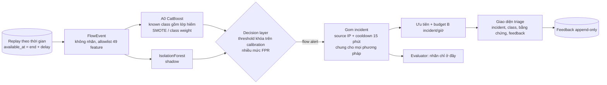

# Research framing — Netirava cho DataNovathon 2026 (DN-CY-01)

**Phiên bản v2 (2026-11-08)**, căn chỉnh theo trang đề bài chính thức. Bản v1 (khung của Astra, trọng tâm là unknown attack) nằm ở git `c9f8c83`.

## 1. Đề bài yêu cầu gì
Nguồn: [trang DN-CY-01](https://datanovathon.com/problems/gamswulvrvtidne).

| Mục | Nội dung chính thức |
|---|---|
| Mô tả | Xây model phát hiện xâm nhập mạng xử lý được dữ liệu mất cân bằng nặng và thích nghi với các kiểu tấn công thay đổi |
| Dataset | Dữ liệu traffic có nhãn, nhiều attack class, mất cân bằng nặng. Không nêu tên dataset, nên dùng **NF-CSE-CIC-IDS2018-v3** (dataset duy nhất của dự án) |
| **Expected outcome** | **(a)** *"A detection model with robust performance on minority classes"*; **(b)** *"an alert triage interface"* |
| Nộp | Code, tài liệu, phần đánh giá, bài trình bày (slide hạn **10/11/2026**) |
| Công nghệ gợi ý | Python, deep learning, **SMOTE**, **ensemble** |
| Metric chấm | Không công bố |
| Tiêu chí chung | Problem Understanding, Innovation & Originality, Technical Depth, Data Usage & Methodology, AI/ML Approach, Solution Quality, Feasibility & Scalability, Real-World Impact, Presentation ("More than a working demo. A thoughtful solution, grounded in data.") |

**Loại giải pháp:** đề bài cần một **method ứng dụng, có bằng chứng định lượng**, không cần một model toán học mới. Innovation đến từ cách kết hợp và áp dụng các kỹ thuật, cùng cách chứng minh (protocol chống leakage, số liệu có CI, kết quả âm được báo). Không gọi kỹ thuật đã được công bố là novelty, và không gọi là SOTA.

## 2. Hai output, hai đơn vị đo (đã chốt)
| Output | Đơn vị | Metric chính |
|---|---|---|
| **(a) Model vững trên minority classes** | **Flow** | F1, recall, precision của từng class kèm support và CI Wilson; **macro-F1 trên các lớp hiếm**; macro-F1 tất cả known class; confusion matrix; benign FPR |
| **(b) Alert triage** | **Incident**: gom các flow bị alert theo **source IP + cooldown 15 phút event time**, dùng **cùng một cách gom cho mọi phương pháp** | Số incident và incident/giờ; **tỷ lệ nén flow → incident**; độ chính xác của incident (incident chứa attack); độ bao phủ episode; **recall@B và precision@B với B incident/giờ** (limiter causal: B incident đầu tiên mỗi giờ); thời gian tới alert đầu tiên |

## 3. Câu chuyện nộp bài
**baseline bỏ sót gì → xử lý bằng cách nào → cải thiện bao nhiêu → trả giá gì → còn giới hạn nào.**

1. **Mất cân bằng (output a).** Lớp hiếm của CIC (Brute_Force_-Web, Brute_Force_-XSS, SQL_Injection: vài trăm đến 1.6k flow, so với hàng triệu flow benign) được **đưa vào known class**.
   - So sánh các cách xử lý mất cân bằng trên cùng dữ liệu: A0 (SMOTE quy tắc LCCDE, chỉ áp cho class < 1000 row), A1 (không SMOTE), A2 (class weight SqrtBalanced).
   - Báo cáo theo class, kèm CI.
2. **Tấn công thay đổi.** Dev unknown là **Bot**. Holdout DDoS LOIC-HTTP **đã được dùng** cho decision layer: V4b bị bác bỏ ([`RESULTS_DECISION.md`](RESULTS_DECISION.md)). Kết quả đó được giữ nguyên.
3. **Nguồn lực analyst (output b).** Gom incident, ưu tiên, budget theo incident, mức nén. Có giao diện triage với feedback.

## 4. Research questions
| RQ | Câu hỏi | Trạng thái |
|---|---|---|
| RQ1 | A0 có vững trên lớp hiếm không, và SMOTE hay class weight giúp hay hại lớp hiếm? | **[CHƯA ĐO]** (v2) |
| RQ2 | A0 bỏ sót những family chưa thấy nào? | **[ĐÃ ĐO]** Bot 0/8 episode ở FPR 0.1%; DDoS holdout 0/10 ở 0.1%, 10/10 ở 0.5–1% |
| RQ3 | Gom anomaly theo entity có giúp không? | **[ĐÃ ĐO]** Có trên Bot ở FPR 1% (dev). **Không** trên holdout DDoS; kém A0 ở 0.5–1%. **Bác bỏ** |
| RQ4 | Gom incident giảm tải analyst bao nhiêu, và giữ được bao nhiêu episode tấn công dưới budget B? | **[CHƯA ĐO]** (v2) |
| RQ5 | Chi phí vận hành? | **[ĐÃ ĐO]** A0 < 1 µs/flow; shadow 3.7–10.8 µs/flow; RSS khoảng 3.6 GB |

## 5. Architecture

## 6. Protocol
- **Known class (gồm lớp hiếm):** train trên phần đầu, đánh giá trên phần đuôi của **cùng episode** (within-episode, lạc quan: mỗi class chỉ có một episode và rất ít attacker IP).
  - Lớp web được lấy từ cửa sổ 22/02 **giới hạn phạm vi quan sát vào các máy chủ web bị tấn công** (mọi flow đi từ hoặc đến các host đó, kể cả benign). Phạm vi này được khai báo rõ và không phải toàn mạng.
  - Không có validation riêng, nên các biến thể A0/A1/A2 **chỉ được báo cáo như ablation**. Model triển khai được chốt trước là **A0** (công thức NP-v1), không chọn theo kết quả trên dữ liệu đánh giá.
- **Unknown:** Bot là dev unknown; DDoS là holdout (đã dùng, không chạy lại với model mới).
- **Threshold:** chọn trên benign của C1 (20/02) ở các mức FPR 0.05%, 0.1%, 0.5%, 1%, rồi khóa. Mức chính là **0.1%**.
- **Luật dữ liệu:** giữ phân bố tự nhiên; nhãn chỉ ở evaluator; collision (XSS|SQLi, Benign|Web) được giữ và báo cáo.

## 7. Luật kết luận
- **Output (a):** tuyên bố "vững trên lớp hiếm" chỉ khi F1 và recall của từng lớp hiếm được báo kèm support và CI, cùng FPR thực tế. Biến thể nào làm tăng recall lớp hiếm nhưng giảm precision hay tăng FPR thì phải báo cả hai chiều.
- **Output (b):** lợi ích triage được thể hiện bằng **tỷ lệ nén** và **recall episode@B**, so với cách xử lý theo từng flow ở cùng budget.
- Mọi claim đều trong phạm vi: replay flow đã hoàn tất, một testbed, development evidence.
