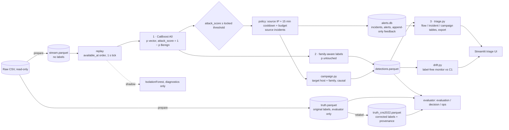

# Kiến trúc

Netirava là IDS chạy trên flow NetFlow v3 đã hoàn tất, dùng dataset replay. Phản ứng (incident, notification) chỉ là mô phỏng: không block, không quarantine, không tự train lại.

## 1. Pipeline

Ba thành phần của giải pháp:
1. **Minority-aware detection:** CatBoost 8 known class, SMOTE quy tắc, kiểm soát chất lượng nhãn (nhãn sửa trong file riêng), threshold khóa trên C1.
2. **Family-aware classification:** họ tấn công luôn có; nhãn mịn chỉ khi đủ tin cậy.
3. **Incident triage:** gom incident, hàng xem xét có budget, view campaign (thử nghiệm), chỉ báo drift, feedback.

## 2. Module (`src/netirava/`)
| Module | Trách nhiệm | Đọc nhãn? |
|---|---|---|
| `config.py` | YAML, path, sha1 | — |
| `features.py` | Allowlist 49 feature, transform cố định, fingerprint, contract runtime (từ chối cột nhãn) | Không |
| `dataset.py` | `inspect`, `prepare` (cửa sổ, scope host), `audit` | Chỉ phía audit |
| `detectors.py` | Train A0 (biến thể a0/a1/a2, seed), IsolationForest; threshold trên benign calibration | Chỉ train/calibration |
| `replay.py` | Replay causal (fast/paced), chấm A0 và shadow, gọi policy, ghi family fields và `campaign_id`; `--model` chọn A0 | **Không** |
| `policy.py` | Candidate → source incident (entity, cooldown), budget theo giờ | Không |
| `family.py` | Implementation duy nhất của family-aware; severity theo nhãn family-aware | Không |
| `campaign.py` | Correlator causal, campaign update, `review_queue` dùng chung | Không |
| `drift.py` | Reference C1, tín hiệu AR/TR/PSI, `DRIFT_MONITOR.parquet` | Không |
| `triage.py` | View flow, incident, campaign và export cho UI | Không |
| `app.py` | Streamlit UI | Không |
| `storage.py` | Thư mục run: `run.json`, `detections.parquet`, `alerts.db` | — |
| `eda.py`, `fe.py`, `fstudy.py` | EDA, pipeline feature, feature study | Có (chỉ inner-train) |
| `evaluation.py`, `decision.py`, `ops.py` | Evaluator: theo scenario, ablation, decision layer V1–V4b, ops study | **Có** |
| `relabel.py`, `pilot.py` | Nhãn sửa CNS2022; pilot trên nhãn sửa | Có |
| `registry.py`, `cli.py` | Sinh registry; mọi lệnh `python -m netirava …` | — |

## 3. Contract của `detections.parquet` (một row mỗi flow)
- Định danh và thời gian: `flow_id, segment, entity, available_at, decision_at, batching_delay_ms`.
- A0: `a0_pred`, `a0_score`, `a0_candidate`, `p_<class>`.
- Policy: `active_action, active_reason, incident_id`.
- Family-aware: `predicted_family, fine_label, fine_label_status, fine_confidence, family_mass, uncertainty_reason`.
- Correlation: `campaign_id` (0 = không alert); `update_id` được tính trong `triage.flow_table`.
- Shadow (mode `a0-shadow`): `an_score, an_would_alert, an_status, shadow_incident_id`.

Run cũ thiếu trường mới được tính lúc load bằng cùng code.

## 4. Bất biến có test
- Nhãn không vào runtime; threshold và model chỉ học từ train/calibration.
- Prefix invariance; chunking và paced cho kết quả giống fast; shadow cô lập.
- Family-aware không đổi xác suất, alert hay incident; incident uncertain không nhận severity của lớp mịn bị giữ lại.
- Correlation không đổi alert hay incident và là causal; tấn công mới gia nhập campaign cũ có mục xem xét riêng.
- Drift monitor không đọc nhãn.
- Feedback append-only; run cũ đọc được.

Trên dữ liệu thật, A0 v2 cho cùng `active_decisions_sha1` (`1c7b4b31…`) trước và sau các tích hợp family-aware và correlation ([`ops_change_audit.md`](ops_change_audit.md)).

## 5. Model
| Model | Thư mục | Ghi chú |
|---|---|---|
| A0 v2 | `artifacts/models/a0` | 8 known class, nhãn gốc, threshold 0.8679 |
| Pilot | `artifacts/models/pilot_cns/s{0,1,2}` | Nhãn sửa; `s0` đang là `final_system.model_dir` (khuyến nghị, chờ chốt) |
| A0 v1 | `artifacts/models_v1/a0` | 5 known class; cần cho run MVP và H1 |
| Ablation | `a1*`, `a2*`, `a0_s1`, `a0_s2` | Không SMOTE, SqrtBalanced, seed khác |
| Anomaly | `artifacts/models/anomaly` | IsolationForest, chỉ shadow |

Chi tiết model ở [`04_modeling.md`](04_modeling.md) §1.
