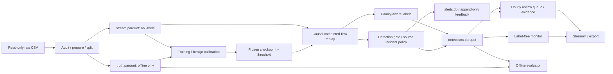

# System architecture

## 1. System interface

Input is a **completed flow**, not a packet stream. Features become available at FLOW_END+export delay; replay decides at the first tick no earlier than that time. Outputs are per-flow decisions, source incidents, review items, and append-only feedback. No live blocking, quarantine, or automatic retraining is performed.

Data, truth, checkpoint, and run have separate manifests/hashes. Label isolation applies to runtime replay/policy/triage/UI; training and evaluators may read labels. CNS2022-adapted truth is a separate CIC artifact.

## 2. Modules

| Module | Responsibility and invariant |
|---|---|
| `config`, `features` | Paths/hashes; 49-feature allowlist; reject labels/quality/role at the runtime contract |
| `dataset` | CIC windows, stream/truth, training/calibration frames |
| `detectors` | A0/IsolationForest, benign-only threshold; checkpoint inference needs no historical recipe |
| `replay`, `policy`, `storage` | Fast/paced scoring, event-time decisions, source cooldown, notification budgets, persistence |
| `family` | Shared abstention/severity; probabilities and gate unchanged |
| `campaign` | Experimental correlation and common causal review queue |
| `triage`, `app` | Flow/incident/campaign views, feedback/export, stream-provenance guard |
| `drift` | Same-checkpoint reference; label-free AR/TR/PSI; no threshold updates |
| `evaluation`, `decision`, `ops` | Offline metrics, variants, episodes, correlation and monitor evaluation |
| `relabel`, `pilot`, `fe`, `fstudy`, `eda`, `ablation`, `inventory`, `ledger` | CIC research and evidence history, outside runtime |
| `external` | Frozen CIC evaluation on UNSW; no fit |
| `ton` | ToN audit/prepare/split/single fit/calibration and original evaluation |
| `ton_reporting` | Post-fit replay/report interface; saved-score provenance, gate metrics, global source novelty; no fit |
| `ui_check` | Real saved-run AppTest without submitting feedback or reading truth |
| `triage_task`, `registry`, `cli` | Formative tasks, generated run inventory, command interface |

ToN reuses A0 inference, replay, policy, family, queue, storage, and UI. Source-specific data preparation, labels/recipe, and evaluation remain explicit instead of introducing another runtime framework.

## 3. Data contracts and invariants

- Model matrix follows `features.FEATURES` in exact order; no source identity, absolute time, labels, dataset ID, or role.
- Derived stream includes features/identifiers/time; role is used to select cohorts and dropped before `flow_event_batch`.
- Detections have one row/flow: score, argmax, candidate, class probabilities, decision time, policy, family, campaign fields.
- SQLite stores incident/notification/feedback, not evaluator truth.
- Run metadata stores checkpoint/threshold/config/stream hashes, segments, counts, timing, decision hash.
- `ton-report` rejects checkpoint/stream mismatch, wrong gate, non-test rows, duplicate/partial test. Global host novelty includes benign and other training classes.

## 4. Operational semantics

| Concept | Meaning |
|---|---|
| Detection | `1-p(Benign) >= locked threshold`; score not probability-calibrated |
| After-gate fine metrics | Threshold+argmax, before abstention in `ton-report` |
| Family-aware | Fine label can be withheld; no detector-recall change |
| Source incident | Source IP + 15-minute gap between candidates; may span hours |
| Notification | FIFO 30 new incidents/clock-hour in final configs |
| Review | Default top ten at end of opening hour; not a full backlog/re-review lifecycle |
| Evidence | Rank uses review-time prefix; UI distinguishes lifetime summaries and scoped details |
| Episode | Bootstrap: label+src+dst; triage: label+src; 30-minute gap; neither is guaranteed independent campaign |
| Monitor | Distribution indicator, not validated FPR estimator or second detector |

## 5. Checkpoint namespaces

| Role | Checkpoint | Data/runs |
|---|---|---|
| CIC final | `artifacts/models/pilot_cns/s0`, `f964bde1ef5c`, threshold 0.009242 | `demo.yaml` or `ops_holdout.yaml` matching the run |
| CIC baseline | `artifacts/models/a0`, `f32899bde8b4` | Report its results separately |
| ToN supplementary | `artifacts/ton_iot_v1/models/a0`, `42b82c1d80ed`, threshold 0.995843 | `artifacts/ton_iot_v1/`, `runs/ton_iot/`, `ton_iot.yaml` |

IsolationForest is historical CIC shadow functionality; no new ToN anomaly model was fitted. Documentation translations/path updates preserve parsed config semantics and archived original hashes; they are not new model experiments.

## 6. Verification

Tests cover causal prefixes/chunking/paced invariance, label isolation, shadow isolation, probability-preserving family labels, same-alert feedback correction, wrong-config handling, single-fit guarding, after-gate metrics, and cross-class host novelty. Synthetic correctness checks do not establish real-world generalization.

[Reproduction](reproduction.md) · [Final report](final_report.md) · [Limitations](limitations.md).
